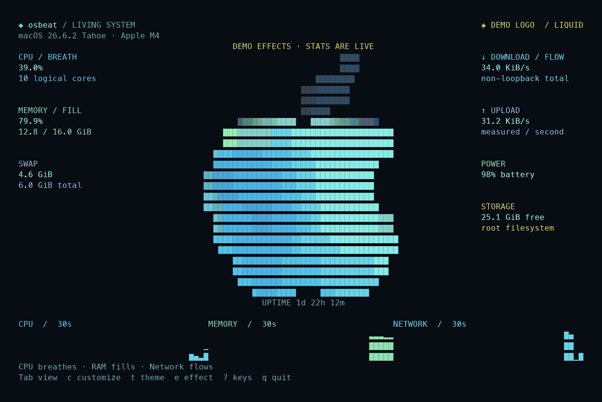

# osbeat

**Your system, with a heartbeat.**

A terminal monitor whose OS logo is alive. CPU makes it breathe. Memory rises
through it like liquid. Network traffic sends a shimmer across its surface.



*Real terminal output, rendered as a GIF. Demo mode drives only logo effects;
measurements stay live. The hostname is hidden in this recording.*

## Run

Rust **1.95+**, macOS, and a truecolor terminal. Apple Silicon is the current
validation platform. Nothing needs sudo or an online account.

```sh
cargo run --release
```

Start with an expressive logo demonstration:

```sh
cargo run --release -- --demo --effect liquid
```

Or install from this checkout:

```sh
cargo install --path . --locked
osbeat
```

This project is not published to crates.io yet.

## Make it yours

Press **c** to customize with a live preview. Change the theme, effect, glyphs,
speed, intensity, frame rate, layout, motion, and visible panels. Press **s** to
save, or keep experimenting without writing anything.

| Key | Action |
| --- | --- |
| `Tab` | Living canvas / detailed dashboard |
| `c` | Live customization panel |
| `t` | Cycle default, Catppuccin, Tokyo Night, Gruvbox, Phosphor |
| `e` | Cycle Aurora, Liquid, Spectrum, Original |
| `g` | Solid / ASCII / dot-matrix logo |
| `a` or `Space` | Pause / resume motion |
| `m` | Toggle labeled logo demo; measurements stay real |
| `s` | Save preferences to TOML |
| `d` | Show osbeat's own CPU and resident memory |
| `?` | Help |
| `Esc` | Close a panel |
| `q` or `Ctrl-C` | Quit and restore the terminal |

In customization, use arrow keys or `j`/`k` to select settings and `←`/`→` to
change them. All changes preview immediately. Help is modal.

Configuration loads from `$XDG_CONFIG_HOME/osbeat/config.toml`, or
`~/.config/osbeat/config.toml`. A normal first launch creates no files.

```sh
osbeat --init-config                      # creates defaults; never overwrites
osbeat --config ./preferences.toml        # explicit paths must exist
osbeat --theme tokyonight --effect liquid
osbeat --dashboard --no-animation
```

Example preferences:

```toml
theme = "tokyonight"
effect = "liquid"
glyphs = "solid"
layout = "focus"
fps = 30
speed = 1.0
intensity = 0.85
reduced_motion = false

[panels]
cpu = true
memory = true
network = true
storage = true
power = true
```

See [the complete example](assets/config.example.toml). Files are validated
strictly; typos and invalid ranges produce errors. Preferences save atomically.
Edit TOML and restart to apply file edits; the in-app controls work immediately.

## The logo is the instrument

- **CPU → breathing.** Utilization controls the pulse frequency.
- **RAM → liquid.** Used memory controls the fill height, with a moving waterline.
- **Network → flow.** Download rate changes shimmer speed, with a logarithmic
  response so both light activity and fast downloads remain visible.
- **Smooth transitions.** Exponential interpolation follows elapsed time rather
  than the number of frames. Data collection and animation have separate clocks.

Aurora combines a cyan/violet glow with a liquid crest. Liquid emphasizes the
memory boundary. Spectrum sweeps a moving rainbow. Original preserves the
fastfetch palette while breathing. Themes style the surrounding interface;
effects control the logo's colors independently.

The engine applies color math to a character mask; it has no Apple-specific
coordinates. To use another logo, point `logo` in your config to a TOML asset:

```toml
logo = "/absolute/path/to/logo.toml"
```

Use the same `name`, `colors`, and `art` structure as
[the bundled logo](assets/logos/macos.toml). Relative paths resolve beside the
config. Custom files are bounded and validated. Glyphs can be ASCII, solid, or
dot-matrix without redrawing the silhouette.

Temperature is **not** inferred from CPU load. Thermal sensors, GPU telemetry,
event glitches, and disk-I/O particles still need real collectors. None are
fabricated in this version.

## Live measurements

The dashboard includes total and per-core CPU, 1/5/15-minute load averages, RAM,
swap, download/upload graphs, root filesystem space, battery state, uptime, and
OS/kernel/host details. Hidden panels disappear and the others reflow.

Core indices are logical cores, not an unverified Apple P/E classification.
RAM is sysinfo's used-memory value, not memory pressure. Network totals aggregate
up, non-loopback interfaces; VPN/tunnel traffic can be counted twice. Interface
names do not prove internet connectivity. Missing readings stay unavailable.

The canvas prioritizes the animated logo. Tab reveals the dense dashboard.
Tiny terminals collapse to numeric readings; resizing both views is tested.

## Performance and architecture

```text
src/
  animation/   smooth, logo-independent color fields
  collectors/  500 ms CPU/network worker; separate 10 s disk/battery worker
  config/      strict TOML, atomic saves, palettes and preferences
  logo/        embedded or custom assets → colored character masks
  ui/          canvas, dashboard, live preview, cached rendering
  app.rs       immutable state updates and keyboard actions
  runtime.rs   independent animation, collection, and input clocks
```

The animation clock targets 30 fps; collectors publish snapshots through
`tokio::sync::watch`. Histories advance only on measured samples. A slow renderer
never accumulates a queue of stale snapshots.

Measured frames rebuild the static UI. Animation ticks update **only changed logo
cells**, then synchronize with Ratatui before the next measured frame. Large
windows cap the logo's painted-cell budget. RGB quantization avoids invisible
changes causing unnecessary terminal writes. Pausing motion disables its timer.

Self CPU is percent of **one logical core**, with no multicore normalization.
The default release target is **under 2% CPU**. `d` exposes self CPU/RAM; `--debug`
starts with it open. Terminal-emulator rendering cost is outside the process's
own CPU measurement. Higher frame rates and custom assets can change cost.

Local validation on **2026-10-28**, Apple M4, macOS 26.6.2, Rust 1.96.0.
Each release-build run used a continuously drained truecolor PTY, 30 fps,
a 3-second warm-up and 35 seconds of process CPU-time measurement.

| Mode | CPU, one core | Resident memory |
| --- | --- | --- |
| Canvas,110×32 | 1.143% | 8.95 MiB |
| Canvas+diagnostics,110×32 | 0.943% | 8.88 MiB |
| Dashboard,110×32 | 1.114% | 8.77 MiB |
| Customization,110×32 | 1.086% | 8.95 MiB |
| Canvas,160×48 | 1.343% | 10.52 MiB |

**70 tests pass; line coverage is 96.5%.** Formatting, warnings-denied Clippy,
and the RustSec dependency audit pass with no known vulnerabilities.
These local results do not guarantee the same cost on every system or custom
configuration; test increased frame rates and large custom assets on your host.


## Verify

Python 3 is needed only for PTY tests and profiling. Runtime has no Python dependency.

```sh
cargo fmt --check
cargo clippy --all-targets -- -D warnings
cargo test
cargo build --release
python3 scripts/terminal_check.py --measure 35
python3 scripts/terminal_check.py --measure 35 --debug
```

The suite covers animation interpolation, fill boundaries, live-frame changes,
config validation, non-overwriting initialization, saves, theme/view/glyph
combinations, direct/full-frame equivalence, overlays, resize, and terminal
restoration on keys and signals. PTY tests use isolated configuration directories.

For line coverage:

```sh
cargo llvm-cov --all-targets --fail-under-lines 80
```

## Still ahead

- Process/event views, connection details, and crash/network-drop reactions.
- Linux distro logo selection and dedicated Linux validation.
- Apple Silicon GPU, power draw, and temperatures without sudo.
- Image-protocol rendering, release automation, and package-manager distribution.

## Credits and license

MIT. The logo art comes from [fastfetch](https://github.com/fastfetch-cli/fastfetch),
also MIT licensed, pinned to revision
`2f68ce7f7467ddbaaf31519c1d41455781d48492`. The original art is preserved as data;
osbeat transforms its presentation at runtime. The six-slot palette has muted
RGB values here. Full upstream copyright and license notices are in
[THIRD_PARTY_NOTICES](THIRD_PARTY_NOTICES). Fastfetch is not invoked at runtime.
